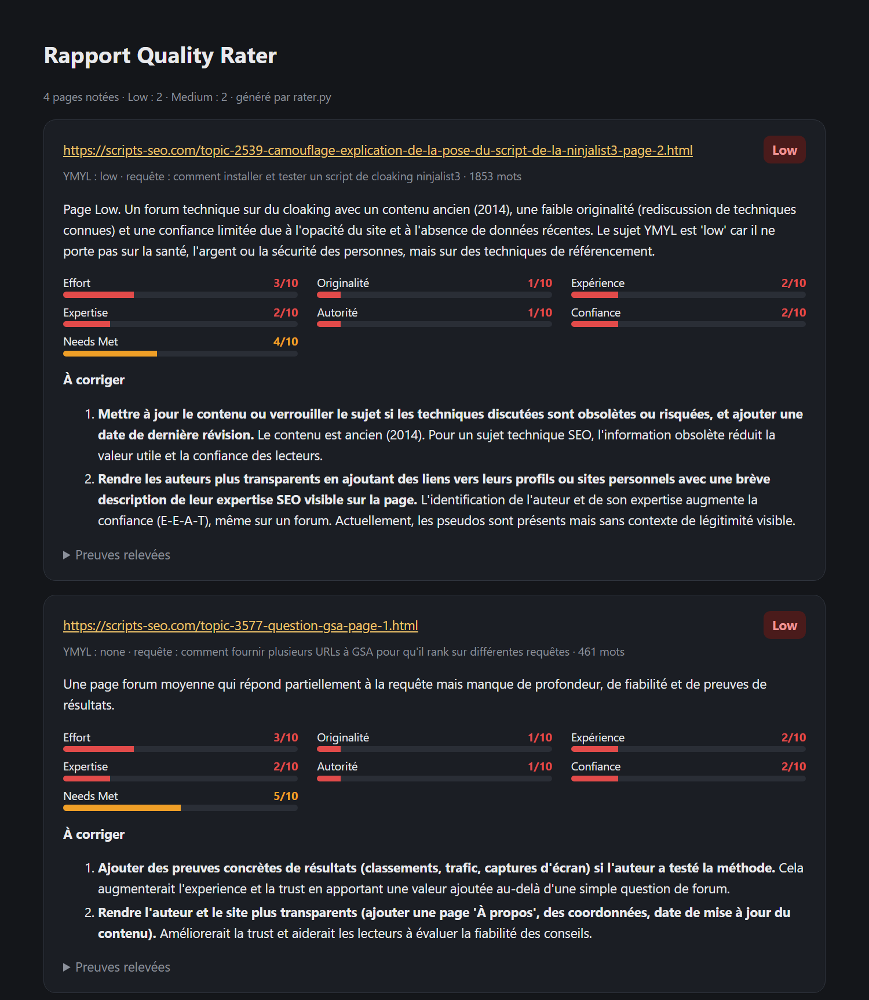

# quality-rater

Rate your pages the way Google's Quality Raters do. Google publishes the guidelines its human evaluators follow
(Search Quality Rater Guidelines, 170+ pages). Their ratings do not rank sites directly: they are used to check that
algorithm changes move results in the direction the guidelines describe. quality-rater turns that method into a grid
and has an AI model apply it to every page of your site.

No dependency: Python 3.9 or later is enough. Works with free models (NVIDIA Nemotron, Cohere trial key), OpenRouter,
Ollama Cloud or any OpenAI-compatible API.


## What it does

1. **Collects the pages** from the sitemap (indexes and `.xml.gz` included, evenly sampled across the whole site), or
   by following internal links when there is no sitemap. It respects `robots.txt` and skips pages in `noindex` (meta or
   `X-Robots-Tag`), pages whose canonical points elsewhere, near-empty pages, archives (categories, tags, authors,
   pagination), section pages made mostly of links, and utility pages (contact, legal, privacy, about). With `--queries`, pages that get Search Console
   traffic are rated first.
2. **Keeps the main content** (`<main>` or `<article>` when present, without the site's menus, headers, footers or
   scripts, but with the article's own header, where themes put the H1, the byline and the date) and extracts the facts
   the model must not guess: author (Schema.org `@graph` included), dates, Schema.org types, images (hosted on the site,
   from stock libraries, alt text, captions), interactive tools (calculators, simulators), tables and embedded videos.
   Site transparency is read from the home page links, then from the About and Legal pages themselves (publisher
   identity, publication director, host), not guessed from keywords.
3. **Rates every page** with the Quality Rater method, in order: purpose of the page, YMYL level, main content
   (effort, originality), E-E-A-T (experience, expertise, authority, trust), Needs Met, and Lowest signals.
   The model lists its evidence before scoring, on an explicit 0-10 scale.
4. **Applies the guideline rules models tend to forget**: the overall rating is not an average. A Lowest signal, or low
   trust on a YMYL topic, caps the rating; High needs clear trust (6/10, 7/10 on YMYL topics) and real added value;
   Highest needs 7/10 everywhere. The report says why a rating was capped.
5. **Sums up the site**: median score per criterion and 3 to 5 site-wide projects, from the fixes that come back on
   several pages (one extra call, `--no-summary` to skip it).
6. **Reports**, in French:
   - `rater-report.html`: the site summary, then one card per page, worst first, with the rating, 7 criteria scored out of 10, the fixes ranked
     by impact and the evidence behind each score;
   - `rater-report.csv`: one row per page (opens in Excel).



## Getting started

Get a free key on [build.nvidia.com](https://build.nvidia.com/) (Nemotron, default), a trial key on
[cohere.com](https://cohere.com/), or use an [OpenRouter](https://openrouter.ai/) or [Ollama Cloud](https://ollama.com/)
key, then:

```bash
export NVIDIA_API_KEY="nvapi-..."            # Windows PowerShell: $env:NVIDIA_API_KEY="nvapi-..."
python rater.py https://example.com
```

Options:

```bash
python rater.py https://example.com --pages 25                       # pages rated (default 10)
python rater.py https://example.com --ai cohere                      # uses COHERE_API_KEY
python rater.py https://example.com --ai openrouter --model name     # uses OPENROUTER_API_KEY
python rater.py https://example.com --ai ollama --model name         # Ollama Cloud, uses OLLAMA_API_KEY
python rater.py https://example.com/a https://example.com/b --one    # only these pages, no crawl
python rater.py https://example.com/a --one --query "target query"   # judge Needs Met against your query
python rater.py https://example.com --ai custom --base-url https://host/v1 --model name --key ...
python rater.py https://example.com --queries gsc.csv               # judge Needs Met against real Search Console queries
python rater.py https://example.com --exclude ""                     # rate archives and utility pages too
python rater.py https://example.com --pause 5                        # slower, if a free key returns 429
python rater.py https://example.com --no-cache                       # rate again pages that did not change
python rater.py https://example.com --workers 6                      # parallel calls (paid keys; default 1)
python rater.py https://example.com --reasoning low                  # let reasoning models think (default: none)
```

### A whole network of sites

```bash
python rater.py --sites sites.txt --pages 10 --workers 8 --out network
```

`sites.txt` holds one site per line (`#` starts a comment, `www.` duplicates are merged). Each site is crawled and
rated on its own, `--workers` sites at a time, and `network/` gets one report per site plus `index.html` and
`reseau.csv`: one row per site, from the weakest (share of Low and Lowest pages) to the strongest, with the median of
each criterion and the first site-wide project.

Reasoning models are asked not to think before answering (`--reasoning none`): the grid already makes them write their
evidence before scoring, and hidden reasoning can use up the whole token budget before any answer comes out, which
made some models ten times slower and costlier for no better rating.

Answers are cached in `.rater-cache.jsonl` by provider, model, settings, grid and page content: running the script again
only rates the pages that changed, and an interrupted run resumes where it stopped. Each run ends with what it used
(calls, tokens, and the billed cost when the provider returns it). A refused key or exhausted credit stops the run at
once instead of failing page after page.

### Real queries from Search Console

`--queries` takes a CSV export with two dimensions, page and query (Search Console API, BigQuery bulk export, or a
spreadsheet add-on: the Search Console web interface does not export both together). Columns are recognised by name:
`page` (or `url`, `landing page`), `query` (or `requête`), `clicks` (or `clics`), `impressions`. Comma, semicolon or
tab separated. Needs Met is then judged against the queries that actually bring visitors, instead of a query the model
infers from the page itself (which tends to flatter the page).

## Reading the results

Fix by type of problem, not page by page:

1. **Low and Lowest pages on YMYL topics** first: they cost the most.
2. **Trust, site-wide**: if most pages ask for an author, dates or an About page, that is one project that lifts the
   whole site.
3. **Needs Met**: answer at the top of the page; when the intent is to calculate or compare, a tool or a table beats
   2,000 words.
4. **Originality**: your own data, a test, a photo, a real case. That is what moves a page from Medium to High.

Well-rated pages look like this: criteria above 7, and only one or two finishing touches left.


## Limits

- This is not Google's rating: it is an AI reading your page with the raters' method. Read the evidence before acting.
- A real rater also checks the site's reputation elsewhere on the web. The script only sees the page.
- Models like to answer Medium: look first at the criteria scored below 4.
- Page content (and, with `--queries`, your Search Console queries) is sent to the AI provider you choose. On
  OpenRouter, requests only go to providers that neither store nor train on them (`data_collection: deny`);
  `--allow-data-collection` lifts that restriction, which some free models need. Free tiers elsewhere may log requests:
  check the provider's terms.
- JavaScript is not run: content injected by scripts is not seen.
- Long pages are cut to `--chars` characters (12,000 by default): the start and the end are kept, the middle is left out.

## Choosing a model

`bench.py` rates the same pages with several models and compares each with the consensus of the others (median
scores, so no costly model is needed as a yardstick and no model judges itself; `--reference premier` uses the first model instead): distance to
the reference, how well each model separates good and weak pages (one that answers Medium everywhere is useless),
stability between two runs, speed, tokens and cost.

```bash
python bench.py https://example.com --pages 8 --repeat 2 --models ollama:model-a,ollama:model-b,openrouter:vendor/model-c
```

Results go to `bench-report.md`, `bench-report.csv` and `bench-report.json` (raw ratings: `--merge a.json,b.json`
compares several runs later without a single new call). `--max-cost 1` stops as soon as the billed cost reaches 1 $.

## Tests

```bash
python test_offline.py .
```

No dependency and no API key: the tests build small local sites and a fake AI provider, then check the crawl, the
extraction, the rating rules, error handling and both scripts end to end.

## License

[MIT](LICENSE)
