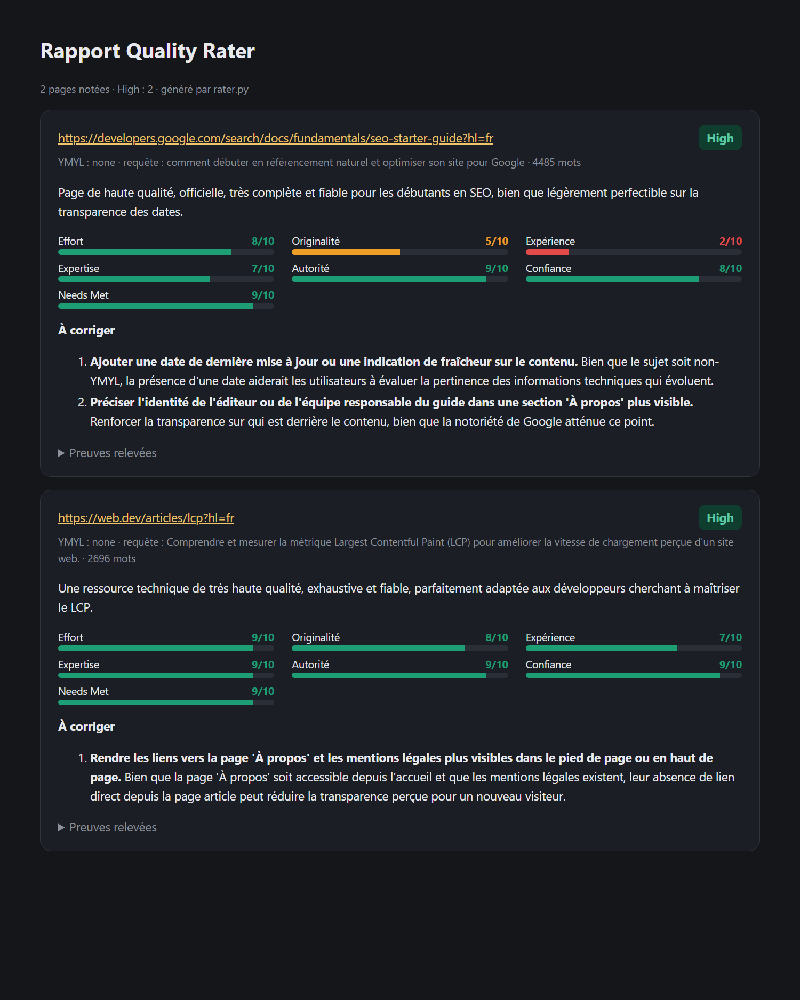

# quality-rater

Rate your pages the way Google's Quality Raters do. Google publishes the guidelines its human evaluators follow
(Search Quality Rater Guidelines, 170+ pages). Their ratings do not rank sites directly: they are used to check that
algorithm changes move results in the direction the guidelines describe. quality-rater turns that method into a grid
and has an AI model apply it to every page of your site.

No dependency: Python 3.9 or later is enough. Works with free models (NVIDIA Nemotron, Cohere trial key) or any
OpenAI-compatible API.


## What it does

1. **Collects the pages** from the sitemap (indexes included, evenly sampled across the whole site), or by following
   internal links when there is no sitemap. Pages in `noindex` and near-empty pages are skipped.
2. **Keeps the main content** (`<main>` or `<article>` when present, without menus, headers, footers or scripts) and
   extracts the facts the model must not guess: author, dates, Schema.org types, links to About / Contact / Legal pages.
3. **Rates every page** with the Quality Rater method, in order: purpose of the page, YMYL level, main content
   (effort, originality), E-E-A-T (experience, expertise, authority, trust), Needs Met, and Lowest signals.
4. **Applies the guideline rules models tend to forget**: the overall rating is not an average. A Lowest signal, or low
   trust on a YMYL topic, caps the rating, and the report says why.
5. **Reports**, in French:
   - `rater-report.html`: one card per page, worst first, with the rating, 7 criteria scored out of 10, the fixes ranked
     by impact and the evidence behind each score;
   - `rater-report.csv`: one row per page (opens in Excel).


## Getting started

Get a free key on [build.nvidia.com](https://build.nvidia.com/) (Nemotron, default) or a trial key on
[cohere.com](https://cohere.com/), then:

```bash
export NVIDIA_API_KEY="nvapi-..."            # Windows PowerShell: $env:NVIDIA_API_KEY="nvapi-..."
python rater.py https://example.com
```

Options:

```bash
python rater.py https://example.com --pages 25                       # pages rated (default 10)
python rater.py https://example.com --ai cohere                      # uses COHERE_API_KEY
python rater.py https://example.com/a https://example.com/b --one    # only these pages, no crawl
python rater.py https://example.com/a --one --query "target query"   # judge Needs Met against your query
python rater.py https://example.com --ai custom --base-url https://host/v1 --model name --key ...
python rater.py https://example.com --pause 5                        # slower, if a free key returns 429
```

## Reading the results

Fix by type of problem, not page by page:

1. **Low and Lowest pages on YMYL topics** first: they cost the most.
2. **Trust, site-wide**: if most pages ask for an author, dates or an About page, that is one project that lifts the
   whole site.
3. **Needs Met**: answer at the top of the page; when the intent is to calculate or compare, a tool or a table beats
   2,000 words.
4. **Originality**: your own data, a test, a photo, a real case. That is what moves a page from Medium to High.

Well-rated pages look like this: criteria above 7, and only one or two finishing touches left.



## Limits

- This is not Google's rating: it is an AI reading your page with the raters' method. Read the evidence before acting.
- A real rater also checks the site's reputation elsewhere on the web. The script only sees the page.
- Models like to answer Medium: look first at the criteria scored below 4.
- Page content is sent to the AI provider you choose. Pages are public, but use your own API if that matters to you.
- JavaScript is not run: content injected by scripts is not seen.

## License

[MIT](LICENSE)
